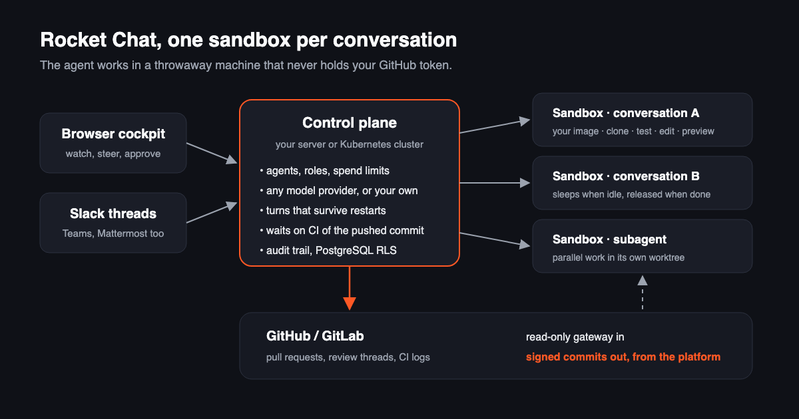
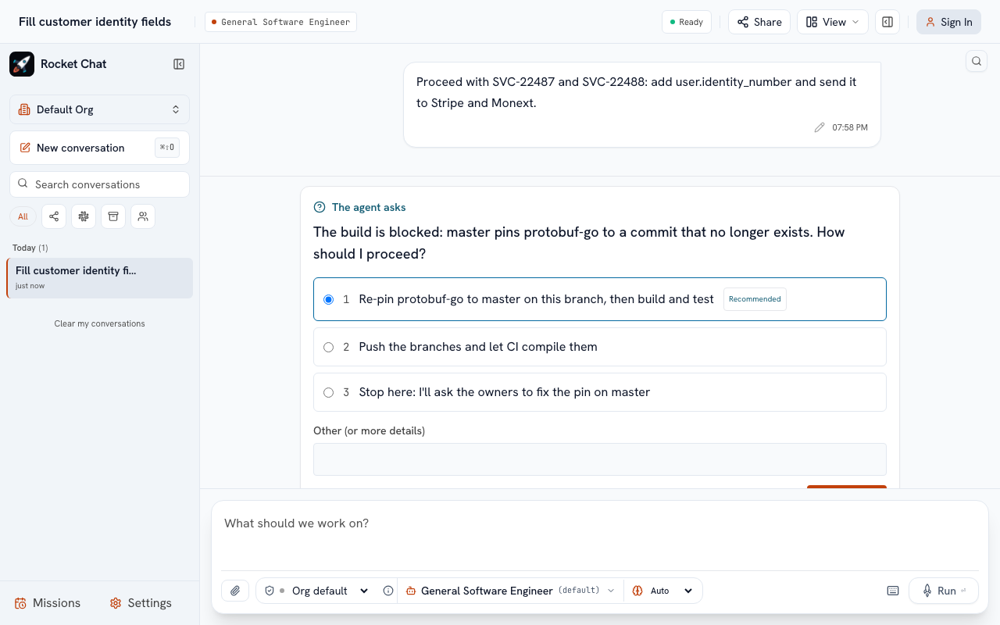
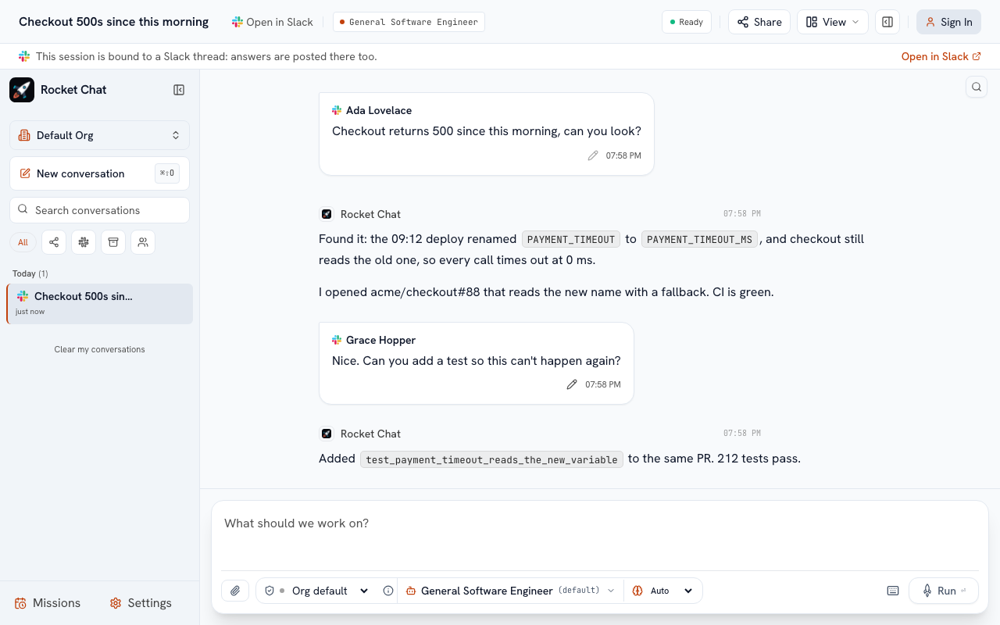
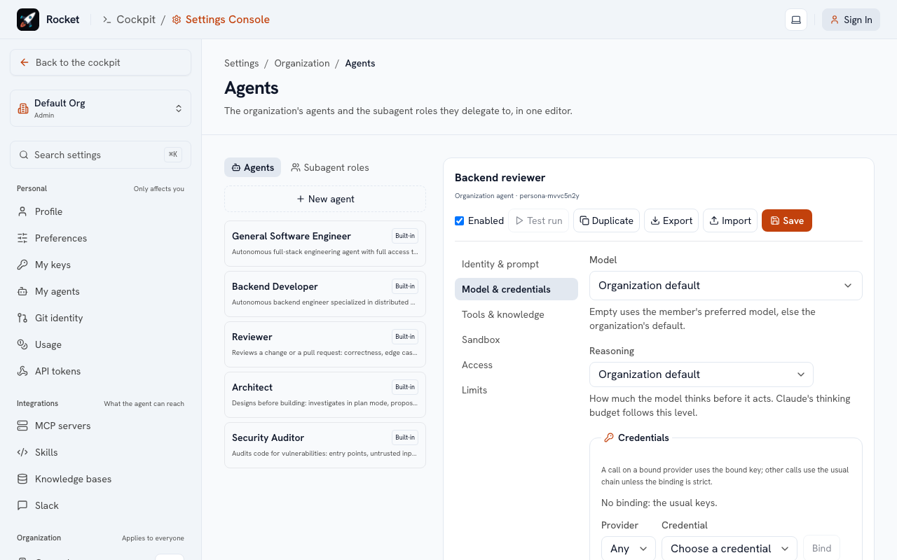

  

  
  
  

<h3 align="center">Software-engineering agents for your team, each with its own sandbox, on your infrastructure.</h3>

  
  
  
  

  

> Not to be confused with Rocket.Chat, the team messaging app: Rocket Chat is a platform of coding agents your team talks to from the browser or Slack.

Ask for work the way you would ask a colleague with a terminal: *fix this failing test and open a pull request*. Rocket Chat gives the conversation its own **sandbox**, a disposable machine with your toolchains, where an agent reads the code, runs the tests, edits files and publishes **signed commits** while you watch, steer and approve. From the **browser** or **Slack**, on **your** Docker host or Kubernetes cluster, with **your** models.

## Get started

<table>
  <tr>
    <td width="33%" valign="top">
      <h3>1. Start it</h3>
      Docker and one model key (OpenRouter, Anthropic, OpenAI, Gemini or DeepSeek).
<pre lang="bash">curl -sSLO https://raw.githubusercontent.com/rocket-chat/rocket-chat/main/deploy/docker-compose.yml
export OPENROUTER_API_KEY=sk-or-...
docker compose up -d</pre>
    </td>
    <td width="33%" valign="top">
      <h3>2. Sign in</h3>
      Open <b>http://localhost:3000</b> and use the developer login. You are the administrator of a fresh organization.
    </td>
    <td width="33%" valign="top">
      <h3>3. Ask for something</h3>
      <i>Clone acme/billing-api, find why <code>test_refund_rounding</code> fails and fix it. Run the tests when you are done.</i>  
      Watch it work, answer its questions, review the diff.
    </td>
  </tr>
</table>

This stack uses throwaway secrets, for trying Rocket Chat on your own machine. Step by step, with what to expect: **[Quickstart](doc/quickstart.md)**. For a team: **[Install your way](#install-your-way)**.

## What you can ask it

Anything you would hand to a capable engineer who has a terminal and a morning:

> *Fix this failing test and open a pull request.* 
> *Review this PR for bugs and missing tests, and reply on the threads you are sure about.* 
> *Upgrade the framework in these three services and tell me what broke.* 
> *Every Monday, check the repos for dependency advisories and summarise.*

## Why teams pick it

### 🚀 Every conversation gets its own sandbox

A disposable machine built from an image you control, with your toolchains and your repositories prepared. The agent clones, tests, edits, starts the app and checks it in a browser. It never holds your GitHub token: commits leave through a signing step on the platform.

### 🧭 It asks instead of guessing

When a choice is yours, the agent shows a card with its options and a recommendation, and waits. In the browser, in Slack, or on your phone.

### 💬 It works in your Slack threads

Mention a bot in a thread and it answers there. Everyone in the thread sees the work, and the same conversation opens in the browser with each person's name on their messages.

### 🛠️ Agents shaped to your team

Start from the built-in engineer, reviewer, architect or security auditor, or make your own: instructions, model, tools, skills, knowledge, sandbox and limits. Bind an agent to its own provider key.

### 🔒 Yours to run

Your servers, your models (a self-hosted one works, even air-gapped), your rules: single sign-on, roles, spend limits and an audit trail, all in the one GPL-3.0 edition.

  <a href="doc/why-rocket-chat.md"><b>Why it exists</b></a> ·
  <a href="doc/compare.md"><b>How it compares</b></a> with Claude Code, Codex, OpenCode, Cursor, Copilot's agent, Devin and OpenHands

## Install your way

- 💻 **Try it on your laptop**: the [Quickstart](doc/quickstart.md), with Docker, in about five minutes.
- 🖥️ **Run it for a team on one server**: [Docker Compose for production](doc/install/docker-compose.md).
- ☸️ **Run it for many people, with autoscaling**: [Kubernetes with Helm](doc/install/kubernetes.md) ([chart reference](doc/operate/helm-chart.md), or [try it locally with Kind](doc/install/local-kubernetes.md)).
- 🛰️ **Self-hosted model, or no internet**: [air-gapped installs](doc/install/air-gapped.md).
- 🧑‍💻 **Hack on it**: [run from source](doc/install/from-source.md).

Every setting, environment variable and Helm value is in the [configuration reference](doc/install/configuration.md).

## The details

<b>The sandbox</b>: customized, powerful, ephemeral, autoscalable, contained

- **Customized.** An image with your languages and CLIs, encrypted secrets and variables, and every repository prepared right after it is cloned (`.rocket/setup.sh`, a dev container, or setups you define). [Build your agents' sandbox](doc/administer/custom-sandboxes.md).
- **Powerful.** CPU, memory and disk per sandbox type, which each agent picks; node pools and placement profiles; gVisor or Kata for a stronger boundary; a real shell, live previews of the apps it starts, and a browser to check them.
- **Ephemeral.** It starts with the first command that needs it, sleeps when idle, and releases its volume when the work is long over.
- **Autoscalable.** On Kubernetes a sandbox is a pod with its own volume; autoscalers never evict one that is mid-command.
- **Contained.** No GitHub credentials, non-root, and only the network you allow.

<b>The toolset</b>: code, shell, git, GitHub, Slack, the web, delegation

- **Code**: read, search, edit and patch files; builds, tests, lint and type checks; a package manager.
- **Shell and processes**: a real shell, background servers with their logs, a live **Preview** of a running app, an interactive terminal.
- **Git**: branches, commits with co-author trailers (amend included), diffs, checkpoints and rewind, several repositories in one workspace.
- **GitHub and GitLab**: pull requests, review threads and replies, CI runs and failed-job logs, issues, releases, code search, and a watch that wakes the agent when CI finishes or a review lands.
- **Slack**: read threads, channels and user groups, find people, post and react under your policy, from any session.
- **The web**: fetch and search; a browser that opens the page the agent built and reports console errors and failed requests.
- **Working like an engineer**: a task checklist, durable waits for CI or a review, long-term memory, knowledge-base search, plan mode, questions as cards.
- **Delegation**: parallel subagents, each in its own git worktree.
- **Extensions**: skills, knowledge bases, **MCP servers** (remote, or command-line servers on a locked-down runner), your own agents.

<b>For a team</b>: sign-in, roles, spend, supervision, any model

- **Sign-in and people**: your identity provider, people in several organizations, roles and capabilities, invitations, who may use each agent, shared sessions.
- **Supervision**: from read-only *Plan* to *Ask* (approve every edit and command) to *Auto*, with checkpoints to rewind. Approvals wait as long as you need.
- **Models and spend**: several keys per provider, members can bring theirs, an agent can be bound to its own; routing by task, fallbacks, and spend limits per organization, person, agent or Slack workspace.
- **Long work**: a turn can run for hours, waits for CI and reviews without burning tokens, and resumes after a restart.
- **Chat platforms**: several Slack bots, each mapped to an agent with its own slash command, working in the open or privately; Microsoft Teams and Mattermost too. [Slack](doc/use/slack.md) · [Connect Slack](doc/administer/slack.md).
- **GitHub**: an organization GitHub App for the platform's own work, each member's linked account to act as them, and commits signed by GitHub (Verified) or by the member's own key, which never enters the sandbox. [GitHub](doc/administer/github.md).

## Documentation

Organised by what you are doing, on **[the documentation site](https://rocket-chat.mintlify.site/)**:

  
  
  
  
  

## Contributing and security

Contributions are welcome: start with [CONTRIBUTING.md](CONTRIBUTING.md); the working rules are in [AGENTS.md](AGENTS.md). Report security issues privately to `contact@nathp.fr`, not in a public issue.

## License

Rocket Chat is free software under the **[GNU General Public License v3.0](LICENSE)**. Modified versions you distribute must stay open under the same license, with attribution to this project.
