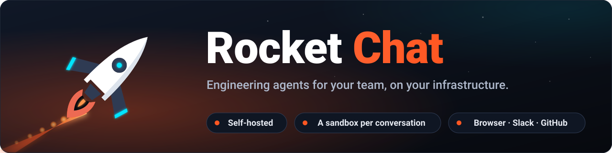

  

  
  
  

<h3 align="center">Software-engineering agents for your team, each with its own sandbox, on your infrastructure.</h3>

  
  
  
  

  

> Not to be confused with Rocket.Chat, the team messaging app: Rocket Chat is a platform of coding agents your team talks to from the browser or Slack.

Ask for work the way you would ask a colleague with a terminal: *fix this failing test and open a pull request*. Rocket Chat gives the conversation its own **sandbox**, a disposable machine with your toolchains, where an agent reads the code, runs the tests, edits files and publishes **signed commits** while you watch, steer and approve. From the **browser** or **Slack**, on **your** Docker host or Kubernetes cluster, with **your** models.

## Get started

<table>
  <tr>
    <td width="33%" valign="top">
      <h3>1. Start it</h3>
      Docker and one model key (OpenRouter, Anthropic, OpenAI, Gemini or DeepSeek).
<pre lang="bash">curl -sSLO https://raw.githubusercontent.com/rocket-chat/rocket-chat/main/deploy/docker-compose.yml
export OPENROUTER_API_KEY=sk-or-...
docker compose up -d</pre>
    </td>
    <td width="33%" valign="top">
      <h3>2. Sign in</h3>
      Open <b>http://localhost:3000</b> and use the developer login. You are the administrator of a fresh organization.
    </td>
    <td width="33%" valign="top">
      <h3>3. Ask for something</h3>
      <i>Clone acme/billing-api, find why <code>test_refund_rounding</code> fails and fix it. Run the tests when you are done.</i>  
      Watch it work, answer its questions, review the diff.
    </td>
  </tr>
</table>

This stack uses throwaway secrets, for trying Rocket Chat on your own machine. Step by step, with what to expect: **[Quickstart](doc/quickstart.md)**. For a team: **[Install your way](#install-your-way)**.

## Why Rocket Chat

- **One sandbox per conversation.** Isolated, disposable, built from an image you control, ready with your tools when the agent arrives. Scales with your cluster.
- **Made for a team.** Single sign-on, organizations and roles, shared sessions, spend limits, an audit trail. All in the one open-source edition.
- **Where your team already works.** The browser cockpit and Slack bots, with questions and approvals as buttons; every Slack thread is also a session in the browser.
- **GitHub end to end.** Pull requests, review threads, CI logs, and commits GitHub marks as Verified.
- **Yours.** Your servers, your models (or a self-hosted one, even air-gapped), GPL-3.0.

## In more detail

| | |
| :--- | :--- |
| **A sandbox of its own, ready on arrival** | Each conversation runs in its own isolated, disposable environment built from an image *you* control: your toolchains, your variables, your repositories prepared. Scales with your cluster. [More below.](#every-conversation-gets-its-own-sandbox) |
| **A team of agents, shaped to your work** | Built-in agents (a general engineer, a backend specialist, a security auditor), editable, or define your own: each with its own instructions, model, tools, skills, knowledge, step budget and sandbox. Agents delegate to parallel subagents. |
| **A team's platform, not a personal tool** | Sign-in with your identity provider, people in several organizations, roles and capabilities, invitations, who may use each agent, shared sessions, spend limits per organization, person, agent or Slack workspace, an audit trail. Included in the one open-source edition. |
| **Yours to run** | Your servers, your cluster, your network. Code and prompts go only to the model you choose, or to none with a self-hosted one ([air-gapped installs](doc/install/air-gapped.md)). |
| **Browser and Slack, both first-class** | Several Slack bots, each mapped to an agent; questions and approvals as buttons; work in the open or privately. Every Slack thread is also a session in the browser. |
| **GitHub, end to end** | Pull requests, review threads, CI logs, PR following, webhooks, and **signed commits** (GitHub's Verified badge, or a member's own key that never enters the sandbox). |
| **Your internal tools, safely** | MCP servers, remote or command-line (stdio). Command servers run on a dedicated locked-down runner, with install scripts and per-member credentials. |
| **You decide how much to trust it** | From read-only *Plan* to *Ask* (approve every edit and command) to *Auto*, with checkpoints to rewind. Approvals wait as long as you need. |
| **Any model** | Your own keys (several per provider, members can bring theirs, an agent can be bound to its own), routing by task, fallbacks, spend limits. No lock-in. |
| **Built for long work** | A turn can run for hours: durable waits for CI and reviews, resume after a restart, parallel subagents. |

[Why it exists and who it is for](doc/why-rocket-chat.md) · [How it compares with Claude Code, Codex, OpenCode, Cursor, GitHub Copilot's agent, Devin and OpenHands](doc/compare.md)

## Every conversation gets its own sandbox

> *Give your agents their own ephemeral, customized, powerful environment, with all their tools already in it.*

- **Customized.** Build an image with your languages and CLIs, set encrypted secrets and variables, and have every repository prepared right after it is cloned (`.rocket/setup.sh`, a dev container, or setups you define). The agent starts working instead of installing. → [Build your agents' sandbox](doc/administer/custom-sandboxes.md)
- **Powerful.** CPU, memory and disk per sandbox type or per agent; node pools and placement profiles; a stronger isolation boundary with a runtime class such as gVisor or Kata; a real shell, live previews of the apps it starts, and a browser to check them.
- **Ephemeral.** It starts with the first command that needs it, sleeps when idle, and releases its volume when the work is long over.
- **Autoscalable.** On Kubernetes a sandbox is a pod with its own volume: capacity follows your cluster, autoscalers never evict a sandbox that is mid-command, and the control plane scales with the Helm chart.
- **Contained.** It never holds your GitHub credentials, runs as non-root, and reaches only the network you allow.

## What is built in

The agents come with a large toolset, so a new organization can do real work on day one:

| | |
| :--- | :--- |
| **Code** | Read, search, edit and patch files; `grep`, `glob` and symbol search; run builds, tests, lint and type checks; a package manager. |
| **Shell and processes** | A real shell in the sandbox; background servers and watchers with their logs; a live **Preview** of a running app; an interactive terminal. |
| **Git** | Branches, commits with co-author trailers, diffs, checkpoints and rewind, multi-repository workspaces. |
| **GitHub** | Pull requests (diffs, review threads, replies, merge), Actions runs and failed-job logs, issues, releases, code search, a watch on a pull request that wakes the agent when CI finishes or a review lands. Publishing with **signed commits**: `github` (GitHub-verified), `member_gpg` (a member's own key, stored encrypted, never in the sandbox) or unsigned. |
| **Slack** | Read the thread, channels and user groups; find people; link messages; post, message and react under your policy. Attachments are read; long answers and diffs are attached as files. |
| **The web** | Fetch and search the web; a browser that opens the page the agent built and reports its text, console errors and failed requests. |
| **Working like an engineer** | A task checklist the team can follow, durable waits (`wait_for` CI, a review, a process), long-term memory, knowledge-base search, plan mode, questions as decision cards. |
| **Delegation** | Subagents, in parallel, each in its own git worktree. |
| **Extensions** | Skills, knowledge bases, **MCP servers** (remote or stdio), your own agents. |

## Slack, built for teams

Several bots, each mapped to an agent (`@RocketDev`, `@RocketOps`, `@RocketTriage`), each with its own slash command. Mention a bot in a thread and it answers there, showing the step it is on and ending with a summary and a link to the session; or work **privately** and share the result when you choose. Questions and approvals are buttons only the requester can press, and they survive a restart. See [Slack](doc/use/slack.md) and [Connect Slack](doc/administer/slack.md).

## GitHub, with signed commits

An organization GitHub App does the platform's own work; each member's linked account lets the agent act as them. The sandbox holds neither: it clones through a read-only gateway, and commits leave through a publishing step that applies your signing policy. Label an issue and an agent can reproduce it, fix it on a branch and open the pull request. See [GitHub](doc/administer/github.md).

## Install your way

| You want to | Start here |
| :--- | :--- |
| **Try it** on your laptop | [Quickstart](doc/quickstart.md) (Docker, two minutes) |
| **Run it for a team** on one server | [Docker Compose for production](doc/install/docker-compose.md) |
| **Run it for many people**, with autoscaling | [Kubernetes with Helm](doc/install/kubernetes.md) and the [Helm chart reference](doc/operate/helm-chart.md) |
| **Try the Kubernetes setup** locally | [Local Kubernetes with Kind](doc/install/local-kubernetes.md) |
| **Use a self-hosted model**, or no internet | [Self-hosted models and air-gapped installs](doc/install/air-gapped.md) |
| **Hack on it**, or run it from source | [Run from source](doc/install/from-source.md) |

Every setting, environment variable and Helm value is in the [configuration reference](doc/install/configuration.md).

## What you can ask it

Anything you would hand to a capable engineer who has a terminal and a morning:

- *Fix this failing test and open a pull request.*
- *Review this PR for bugs and missing tests, and reply on the threads you are sure about.*
- *Upgrade the framework in these three services and tell me what broke.*
- *Why is this endpoint slow? Reproduce it, profile it, propose a fix.*
- *Every Monday, check the repos for dependency advisories and summarise.*

## Documentation

**[The documentation site](https://rocket-chat.mintlify.site/)** is organised by what you are doing:

| | |
| :--- | :--- |
| [Install](doc/install/index.md) | Docker Compose, Kubernetes, local clusters, from source, air-gapped. |
| [Use](doc/use/index.md) | Your first session, supervision, Slack, templates, schedules, skills. |
| [Administer](doc/administer/index.md) | Sign-in, members and roles, models and credentials, spend limits, GitHub, Slack, sandboxes, security and audit. |
| [Operate](doc/operate/index.md) | Helm values, hardening, backups, monitoring, troubleshooting. |
| [API](doc/api/index.md) | REST and the live WebSocket protocol, to build on top of it. |

## Contributing and security

Contributions are welcome: start with [CONTRIBUTING.md](CONTRIBUTING.md); the working rules are in [AGENTS.md](AGENTS.md). Report security issues privately to `contact@nathp.fr`, not in a public issue.

## License

Rocket Chat is free software under the **[GNU General Public License v3.0](LICENSE)**. Modified versions you distribute must stay open under the same license, with attribution to this project.
