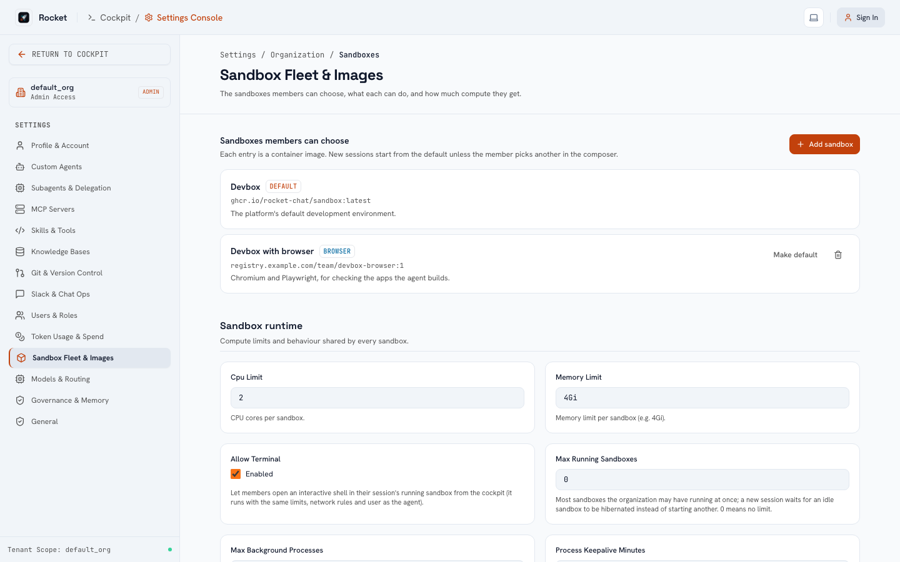

# Sandboxes

A **sandbox** is the container a session runs in. You decide which ones your organization offers under **Settings → Organization → Sandboxes**.

## The catalogue

Each entry has a **name**, an **image**, a **description**, optional **capabilities** and exactly one is the **default**.

* The first time your organization is used, the catalogue is created with one entry: the deployment's default image (`ROCKET_DEFAULT_SANDBOX_IMAGE`; the development image with git, GitHub CLI, Python with `uv`, Node and build tools), plus any images an older install had allowed.
* Members choose a sandbox when they start a session (a picker appears once there are two or more); a session keeps the one it started with. Starting a session with an image that is not in the catalogue is refused.
* You cannot remove the default or the last entry; make another entry the default first.
* Changes are recorded in the audit log.

Build your own image from the development image to add toolchains and warm caches (`FROM` the default, add what your repositories need), push it to a registry the cluster can pull from, and add it here. Installed dependencies persist in a session's workspace across restarts, so a custom image mostly saves the first install.

## Capabilities

| Capability | What it enables | What the image must contain |
| :--- | :--- | :--- |
| **Browser tools** | The agent can open a page it built and read its text, console errors and failed requests, optionally with a screenshot (`browser_inspect`). | Chromium and Playwright. The `rocket-chat-sandbox-browser` image (built from `deploy/docker/Dockerfile.sandbox-browser`) has both. |

Capabilities are an explicit promise: ticking *Browser tools* on an image that lacks Chromium makes the tool fail, and an entry without it never offers the tool. **Looking at images** is not a sandbox capability: the agent can open any image in the workspace (`view_image`), and whether it can see it depends on the model.

## Resources and behaviour

Under **Sandbox runtime** on the same page:

| Setting | Effect |
| :--- | :--- |
| CPU and memory limit | Per sandbox. |
| Maximum running sandboxes | Per organization; at the cap, an idle sandbox is put to sleep to make room. `0` means no limit. |
| Require non-root | Refuse images that run as root. |
| Allow terminal | Let members open an interactive shell in their sandbox. |
| Run repository setup | Run `.rocket/setup.sh` / dev container hooks after the agent clones a repository. |
| Maximum background processes | Servers and watchers one session may run at once (default 5). |
| Process keep-awake (minutes) | How long a sandbox with a running process is kept out of idle sleep. |

## Network egress

The governance settings can restrict what a sandbox reaches: an allowlist of hosts, CIDRs or `*.suffix` names, and blocking internal subnets (including the cloud metadata address). Rules are applied to the **resolved** address, on Docker through an allow-listing proxy and on Kubernetes through network policy. Loopback always works, so previews and local servers keep working.

## Sleeping and cleanup

A sandbox with no activity for the idle period is stopped and its workspace volume is kept (the operator sets the period with `SANDBOX_INACTIVITY_PAUSE_SECONDS`: 30 minutes on Docker, 10 minutes on Kubernetes by default). Workspaces are removed with their session. Running processes end when a sandbox sleeps.
