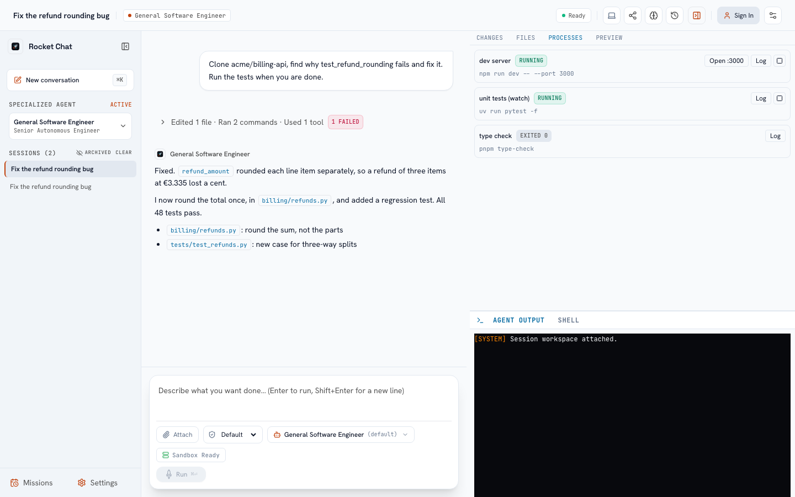

# Rocket Chat

Rocket Chat is a software-engineering agent your team can talk to in the browser or in Slack. Each conversation gets its own **sandbox** (a container with git, Python, Node and your tools) where the agent reads code, runs commands and tests, edits files and starts the apps it builds, while you watch, steer and approve.

## Start here

| I want to... | Go to |
| :--- | :--- |
| **Run Rocket Chat** on my machine or my cluster | [Install](/install/index) |
| **Use it**: ask for work, review changes, work from Slack | [Use Rocket Chat](/use/index) |
| **Set it up for my team**: sign-in, models, GitHub, Slack, sandboxes, policies | [Administer](/administer/index) |
| **Keep it running**: upgrades, backups, monitoring, incidents | [Operate](/operate/index) |
| **Integrate**: REST API and the live WebSocket protocol | [API](/api/index) |

## What you get

* **A real environment per conversation.** The sandbox starts blank; the agent clones the repositories a task needs, installs what it needs and works in a persistent workspace that survives restarts.
* **You stay in control.** Choose how closely the agent is supervised, from read-only planning to approving every edit and command. Questions and approvals appear as cards you can answer from the browser or from Slack.
* **See the work.** Changes as diffs, the workspace as files, running servers in a Preview tab, background processes with their logs, an interactive shell, and a trace of every turn.
* **In Slack too.** Mention a bot, message it, or use its slash command; its reply shows each step as it works, then the answer. Every Slack thread is also a session you can open in the browser.
* **Your models, your rules.** Bring your own provider keys or a self-hosted model; organization policy controls models, tools, spend, data handling and sandboxes.

Developers extending Rocket Chat itself should read the [developer documentation](https://github.com/rocket-chat/rocket-chat/tree/main/dev) in the repository; this site is for people who install, use and run it.
