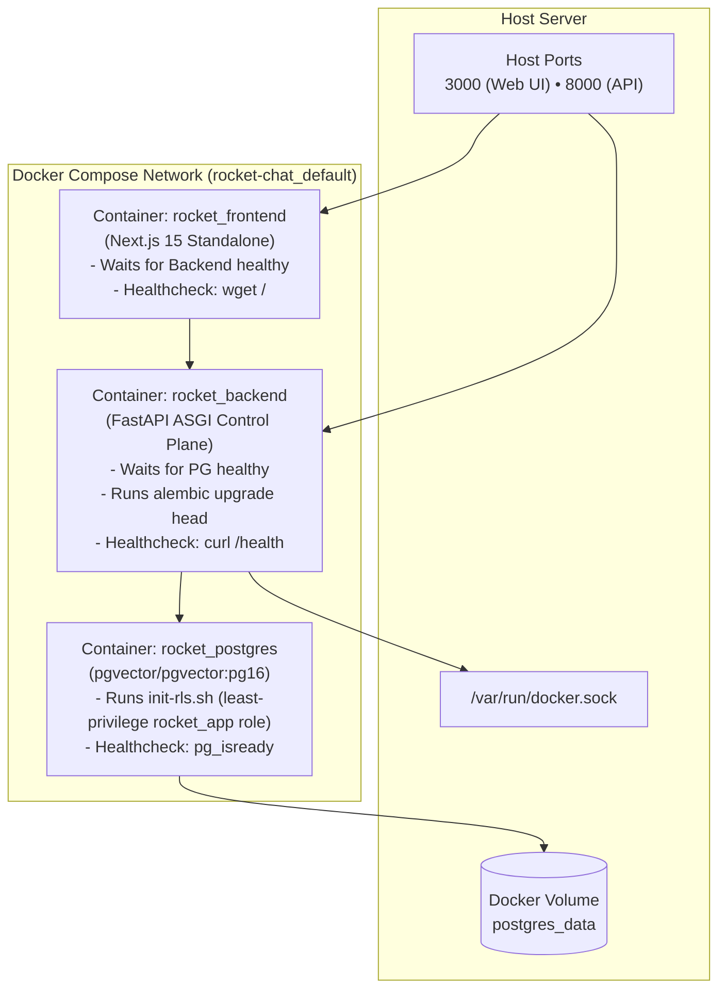

# Production Docker Compose

For single-node servers, internal departmental tools, and staging instances, Rocket Chat provides a complete, turnkey Docker Compose deployment in `deploy/docker-compose.prod.yml`.

---

## 1. Stack Topology

The compose stack spins up three healthy, interconnected containers:



---

## 2. Launching the Production Stack

The stack **refuses to start without real secrets** and runs the API with `ENVIRONMENT=production`:
no developer login, no anonymous identity, no trusted proxy headers, secrets and sign-in required.

```bash
cd rocket-chat

# 1. Create your settings: every REQUIRED value, plus one sign-in method (OIDC, GitHub or Google)
cp deploy/.env.example deploy/.env
$EDITOR deploy/.env          # generate secrets with: openssl rand -hex 32

# 2. Start the stack in the background
docker compose --env-file deploy/.env -f deploy/docker-compose.prod.yml up -d
```

Put a TLS-terminating reverse proxy in front of ports 3000 and 8000 and set `NEXTAUTH_URL`,
`NEXT_PUBLIC_API_URL` and `NEXT_PUBLIC_WS_URL` to the public URLs. PostgreSQL is not published to the host.

> **Security note.** The Docker sandbox driver needs the host's Docker socket, which is equivalent
> to root on the machine for anyone who controls the backend. Use this stack for a single trusted
> team; for multi-user or internet-facing installs use the Kubernetes driver with the Helm chart.

### Health Check Verification
```bash
docker compose --env-file deploy/.env -f deploy/docker-compose.prod.yml ps
```
All services (`rocket_postgres`, `rocket_backend`, `rocket_frontend`) must report healthy status.

---

## 3. Automated Database Initialization & Migrations

1. **RLS User Provisioning (`init-rls.sh`):** On first boot the Postgres container creates the non-superuser `rocket_app` role with the password from `ROCKET_APP_DB_PASSWORD`. The role can read and write rows but cannot create or alter tables; it is the role PostgreSQL's row-level security actually binds.
2. **Schema Migration Entrypoint (`entrypoint.backend.sh` -> `migrate.sh`):** When the backend starts, its entrypoint applies `alembic upgrade head` as the schema owner (`ADMIN_DATABASE_URL`), so all tables, indexes and Row-Level Security policies exist before traffic is served. The API itself only verifies the schema version.

---

## 4. Docker Sandbox Integration

The backend container mounts `/var/run/docker.sock`:
```yaml
volumes:
  - /var/run/docker.sock:/var/run/docker.sock
```
This enables `DockerSandboxDriver` inside the container to dynamically spin up sibling sandbox containers on the host Docker daemon.
