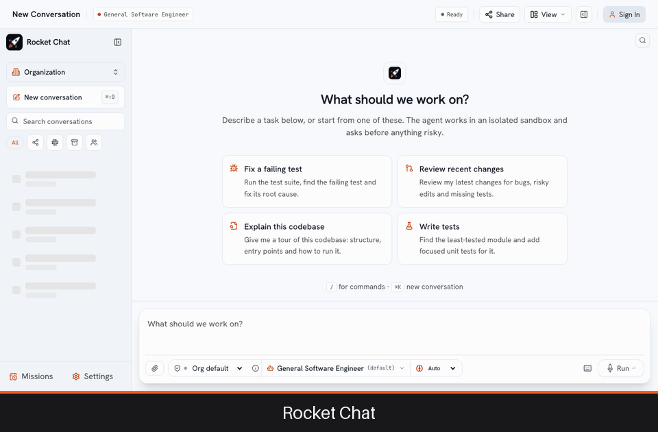

# Quickstart

You will start Rocket Chat on your own machine, give it a model, and ask it to do real work. It takes about five minutes, most of it waiting for images to download.



## Before you start

* **Docker** with the Compose plugin (Docker Desktop on macOS or Windows, Docker Engine on Linux). Rocket Chat starts each conversation's sandbox as a container on this Docker host.
* **A model key** from one of OpenRouter, Anthropic, OpenAI, Gemini or DeepSeek. OpenRouter is the easiest way to try several models with one key.
* A few gigabytes of free memory and disk: the stack runs a database, the API, the web app, and one container per conversation.

> **This stack uses throwaway secrets and a one-click developer login.** It is for trying Rocket Chat on your own machine. For anything other people can reach, use [Docker Compose for production](/install/docker-compose) or [Kubernetes](/install/kubernetes).

## 1. Start it

```bash
curl -sSL https://raw.githubusercontent.com/rocket-chat/rocket-chat/main/deploy/docker-compose.yml -o docker-compose.yml
export OPENROUTER_API_KEY=sk-or-...     # or ANTHROPIC_API_KEY, OPENAI_API_KEY, GEMINI_API_KEY, DEEPSEEK_API_KEY
docker compose up -d
```

Wait until every container reports `healthy`:

```bash
docker compose ps
```

You should see `rocket_postgres`, `rocket_mcp_runner`, `rocket_backend` and `rocket_frontend`.

## 2. Sign in

Open **http://localhost:3000**. On the sign-in page, use the developer login: keep the defaults (`developer`, `default_org`) and press **Enter Flight Deck**. You are an administrator of a fresh organization.

## 3. Ask for something

You land on an empty conversation. The agent starts with a **blank sandbox** and clones whatever the task needs, so you can name a public repository straight away:

```text
Clone octocat/Hello-World, add a short "Getting started" section to the README, and show me the diff.
```

Press **Enter**. The conversation shows what the agent does as it goes: its reasoning, each command with its output, each edit as a diff. Open the right-hand panel to see the **Changes**, the **Files**, and the **Processes** it started.

> **Your own repositories.** To work on private repositories, link your GitHub account in **Settings → Git & GitHub**, or have an administrator connect a GitHub App ([GitHub](/administer/github)).

## 4. Stay in control

Under the composer, **Permission mode** sets how closely the agent is supervised:

| Mode | What waits for you |
| :--- | :--- |
| **Read-only** | Everything: the agent only investigates and proposes a plan. |
| **Ask first** | Every edit, command and publish (commit, branch, pull request). |
| **Auto-edit** | Commands and publishing. Edits run freely. |
| **Auto** | Only irreversible actions: merging a pull request, deleting on GitHub, a hard revert. |

Reading files, searching and cloning never need approval. Questions and approvals arrive as cards and wait as long as you need. **Stop** ends a turn; typing a new instruction steers it.

## 5. What to do next

| I want to | Go to |
| :--- | :--- |
| **Use my own repositories**: clone, push branches, open pull requests | [GitHub](/administer/github) |
| **Bring it to Slack**: mention the bot in a thread and watch it work | [Connect Slack](/administer/slack) and [Slack](/use/slack) |
| **Add my team**: sign in with the identity provider, roles, budgets | [SSO](/administer/sso) and [Organization settings](/administer/organization) |
| **Run it for real**: one server, or many people | [Install](/install/index) |
| **Understand what I can do with it** | [Your first session](/use/index) and [How sessions work](/use/sessions) |

## If something does not work

| Symptom | Check |
| :--- | :--- |
| A container is not `healthy` | `docker compose logs backend` shows why; the usual cause is a port already in use (3000, 8000 or 5432). |
| The agent answers with a model error | The key was not passed to the backend: run `docker compose down`, export the key again in the same shell, and `docker compose up -d`. Or add your key in **Settings → My models & keys**. |
| The agent cannot start its sandbox | The backend could not reach the Docker socket. Check that Docker is running and, on Linux, that `/var/run/docker.sock` exists. |
| You want to start over | `docker compose down -v` removes the containers and the database volume. |

More in [Troubleshooting](/operate/troubleshooting).

## Stop it

```bash
docker compose down        # keep your conversations
docker compose down -v     # and delete them
```
