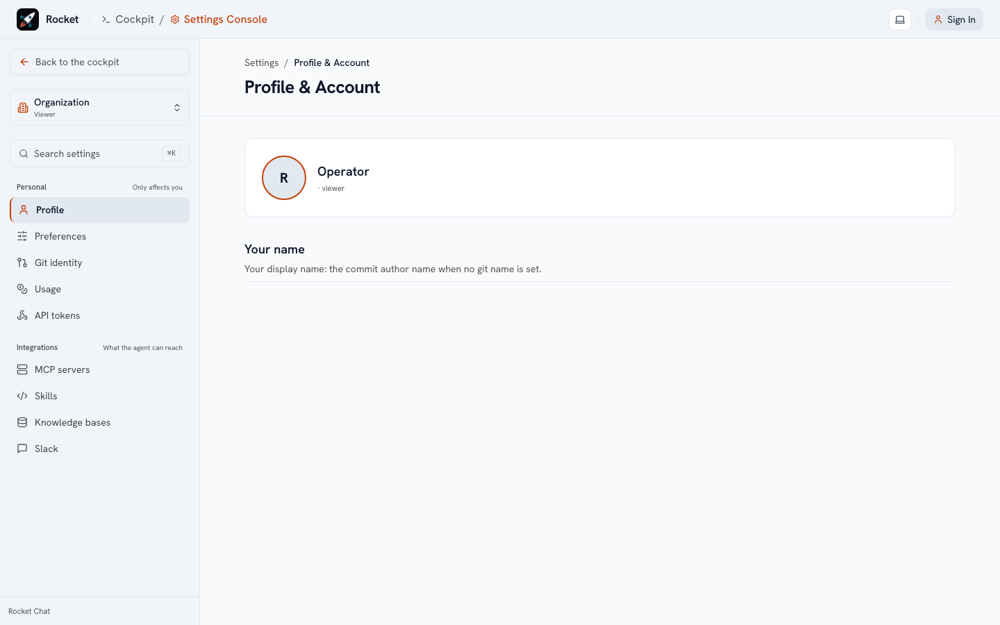

# Your settings

Open **Settings** from the sidebar (or the **View** menu in a session). The list has three groups: *Personal* (only affects you), *Agent capabilities* (agents, subagents, MCP servers, skills, knowledge bases) and *Organization* (administrators; see [Administer](/administer/index)). When an administrator **locks** a setting you see it as *locked by organization* and cannot change it. The foot of the list shows the version of the running server (`v0.5.0`), or `dev` when it was built from source rather than from a release.

**Saving.** A page never has a Save button per section. Edit as many fields as you like and a bar at the bottom shows how many changes are unsaved, with one **Save changes** and one **Discard**. Rarely changed settings are folded under **Advanced**, a number shows what it counts (minutes, USD, tokens), and **Reset to default** puts a changed value back.

**Finding a setting.** Press **⌘K** (Ctrl+K) in Settings, or click **Search settings**, and type what you want to change ("monthly spend", "retention"): the page opens scrolled to that setting.

## Profile and preferences

* **Display name.** Shown on your messages in shared sessions.
* **Suggest next prompts.** The ghost text in the composer that you accept with **Tab**; turn it off if it distracts you.
* **Default permission mode.** How closely the agent is supervised when you do not pick a mode for a session (*Read-only*, *Ask first*, *Auto-edit*, *Auto*, *No approvals*). See [How sessions work](/use/sessions#supervision).
* **Preferred model.** The model your sessions use unless the agent or the organization decides otherwise.

## Git and GitHub

* **Linked GitHub account.** Link it through OAuth so the agent can clone your private repositories and push branches as you; re-link or unlink at any time. Without a link, the organization's GitHub App installation is used, with read access to what it was granted.
* **Personal access token.** An alternative to linking: paste a classic or fine-grained token; the page tests what it can do.
* **Committer identity.** The name and e-mail on commits the agent makes for you.
* **Branch prefix.** New branches the agent creates start with it (for example `alex/rocket-`).
* **Your git policy.** Commit authorship, who opens pull requests and how commits are signed. Each follows your organization's choice (**Org Default**) until you change it; the reset button next to a field you changed makes it follow the organization again. A field your administrator locked cannot be changed.

The page shows which credential the sandbox will actually use (yours, or the app's read-only token), so a failed push is never a mystery.

## Models and keys

If your organization allows it you can add **your own provider key** (OpenRouter, Anthropic, OpenAI, Gemini, DeepSeek): it is stored encrypted, used only for your sessions, never shown again, and your usage is billed to you. Your usage and spend are listed under *Token usage*.

## API access

**Settings → API access** creates the tokens that let a script or another tool call the API as you, without signing in through the browser.

* **Create.** Give the token a name and a lifetime (30 days, 90 days or one year). The token is shown once, right after you create it: copy it then, because only a hash is stored. You can hold up to 20.
* **Use.** Send `Authorization: Bearer rcpat_…` with any REST request, or `?token=rcpat_…` when opening the WebSocket. A token acts as you with the role you hold when it is used, and cannot create another token. The [API reference](/api/rest) lists every endpoint.
* **Revoke.** The trash button stops a token at once. The table shows when each token was created, expires and was last used.
* **Guest tokens (administrators).** For a client that has no account here, such as a bot. Each guest token acts as its own guest member, which can hold conversations and nothing else. They are listed and revoked in the second section of the same page.

## Slack

* **Link your Slack account** with the bot's `pair` command in Slack (for example `/rocky pair`) and the code it gives you (see [Slack](/use/slack)).
* **Notifications.** Receive a Slack message when a long-running request finishes.

## Your own tools

Personal [skills, connectors, knowledge bases and agents](/use/extend) have their own pages in the same list. Anything you create there is private to you unless you are an administrator sharing it with the organization.
