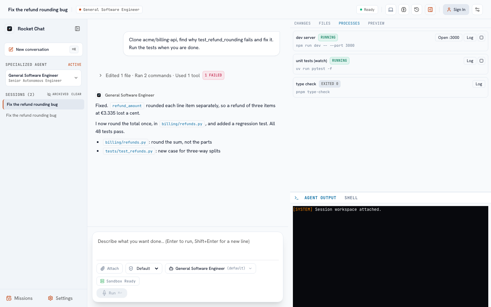

# How sessions work

## The sandbox

Every session has a **sandbox**: a container (Docker locally, a pod on Kubernetes) with a persistent `/workspace` volume. The agent runs commands and edits files there; nothing it does touches your machine or other people's sessions.

* **It starts blank.** No repository is checked out. The agent works out whether the task needs code and which repository, then clones it into `/workspace/<name>`. It finds repositories from your request, your organization's knowledge bases and skills, and read-only GitHub lookups (search, README, issues).
* **It is started when needed.** The first tool that needs a sandbox starts it; opening an old session does not.
* **It sleeps when idle** (after 10 to 30 minutes, set by the operator) and wakes on your next message. The workspace is kept: files, installed dependencies and clones survive. **Running processes do not**: a server the agent started ends when the sandbox sleeps (the Processes tab shows it as *lost*). A sandbox with a running process is kept awake for a while (your organization sets how long) as long as you use it.
* **Which image?** Your organization offers one or more sandboxes (the default is a development image with git, GitHub CLI, Python with `uv`, Node and build tools). Some can have extra abilities such as a headless browser the agent uses to check the app it built.
* **Commands run in bash** (sh only in an image without it), each in a fresh shell. Variables every command needs come from the sandbox type (set by an administrator, secrets included) or from the agent itself: `env_set` sets one for the rest of the session, `env_unset` removes it, `env_list` shows them.

## Repositories and GitHub

The agent clones with your linked GitHub account, or your organization's GitHub App installation when you have not linked one, and tells you plainly when GitHub refuses access instead of hunting for tokens. If a cloned repository contains `.rocket/setup.sh` (or a dev container with `onCreateCommand` / `postCreateCommand`), that setup runs once in the clone, without your GitHub token in its environment. Branches the agent creates follow the prefix you set under *Git identity*.

Link GitHub under **Settings → Git identity**. Templates, schedules and GitHub-triggered work can name a repository; it then becomes the first line of the instruction ("Clone it first").

## Sharing a session

Choose **Share** in the session header (owner or administrator):

* **People** - list the email addresses of members of your organization (one per line or comma-separated). They can read the session and send messages in it. Addresses that are not members are reported and not added; nobody is invited by email. Tick **Everyone in the organization** to share with all members. A message someone else sends runs as them: their own keys, spend limits, capabilities and access to the session's agent apply, not yours.
* **Public link** - a read-only link anyone can open without signing in. It shows the conversation (what was asked and answered), the steps behind each answer (folded, each command, edit and result cut to a short excerpt) and the session's artifacts, all with your organization's redaction rules applied; never the agent's reasoning or the terminal. It expires after 1, 7 or 30 days, and can be revoked at any time (creating a new link also ends the previous one). The link is a secret: anyone who has it can read the conversation, so share it as you would a document. Links exist only if an administrator turned on **Public session links** (*Settings → Organization → General*); turning it off ends every link at once.

Sharing changes are recorded in the audit log.

## Multi-repository workspaces

A session can house multiple cloned repositories under `/workspace`. The platform tracks and coordinates cross-repository operations:

* **Workspace manifest (`workspace_status`)**: Scans all cloned repositories, detects inter-package dependencies across `package.json`, `go.mod`, `Cargo.toml`, and `pyproject.toml`, computes topological dependency order, and updates `/workspace/.rocket/workspace.json`.
* **Cross-repo status (`git_status_all`)**: Inspects branches and dirty worktrees across all workspace repositories at once.
* **Batch read/verify commands (`repo_foreach`)**: Executes verification commands (tests, linting, git logs) across all or filtered subsets of repositories, clamping outputs and aggregating exit statuses.

## Durable waits and long-running sessions

Complex engineering missions can span many hours and multiple turns:

* **Talking to a running agent**: you do not have to wait for a turn to end. While the agent works, type a message and choose **Send** (or press Enter): the agent reads it at its next step, as you would interrupt a colleague, and the conversation shows it where the agent saw it. Use **Stop** to end the turn instead.
* **No step limit for long work**: an organization or an agent can set *Max steps per turn* to `0`. The turn then runs until the agent answers, you stop it, or a cost limit is reached, without being told to wrap up halfway through. The agent is never paused to ask you whether to continue: when it repeats a failing command or an edit, or re-sends the same call with the same result, it is told so and changes course on its own (only sessions in the *Ask* permission mode stop to ask you).
* **Durable waits (`wait_for`)**: The agent can pause execution without consuming tokens or CPU while waiting for external conditions: `ci_status(pr)`, `review(pr)`, `process_exit(pid)`, or timed delays. The session transitions to a waiting state, registers wake hooks with webhooks or timers, and automatically resumes when the condition is met. A CI wait is about the commit the agent last pushed: right after a push the pull request still points at its previous commit for a few seconds, and that commit's result is never reported as the new one's; a CI webhook about an older commit is shown but does not wake the agent. Waiting for CI that has already finished on that commit, or on a pull request where no CI runs (for example a branch behind its base), answers at once and the agent carries on in the same turn instead of waiting. Waits that fall due together wake the session once. A second wait on the same target replaces the first, a wait ends when its result arrives, and stopping the session cancels its waits, so a stopped session is never restarted by an old wait.
* **Automatic goal continuation**: When a long task hits its turn step ceiling but still has pending items in its checklist or `.rocket/PLAN.md`, Rocket Chat automatically schedules continuation turns up to safety budget limits (tokens, wall time, cost), resuming execution with fresh context and working memory.
* **Cost and tokens**: the header shows what the session has cost so far and, on a wide screen, its tokens. Click it for the breakdown: tokens in, the share the provider served from its cache, tokens out and the number of model calls, then each turn (the running one included) and each model, dearest first. Figures are counted call by call as they happen, so they climb while a turn runs and settle when it ends; a turn includes the calls made when it finishes (the title, the summary and the suggested next prompt). Cost is what the provider billed, and cached tokens cost less. The turn inspector shows a running turn's tokens and cost too, which its trace only records once the turn ends. Spend paid with your own provider key is shown apart. When a spend limit applies to you, the header also shows the tightest one left ("$3.10 left today"); a turn a blocking limit stops shows which limit, what was spent and when it resets. Each finished turn also shows how long it took; hover the time to see how many steps the agent took and how much of it the model spent generating against the time tools ran, plus any context compaction (and whether its summary had to be rebuilt from the tool history).
* **Compaction checkpoints** (shown as a short card in the conversation: how many messages were compressed and the token counts, with the summary the agent continued from folded behind a toggle): Long sessions automatically compact earlier conversation history into structured summaries, persisting durable checkpoints to the database. If a session or pod restarts, execution resumes seamlessly from the latest compaction boundary. Compaction keeps the conversation under the organization's *working context size* (200,000 tokens by default) even on models with a larger window, which keeps each step fast and the agent focused.
* **Commands show where they ran**: each command step reads as the command and its folder ("Ran `pytest -q` in api"); the agent names the folder rather than prefixing every command with `cd`.

## Subagents

The agent hands focused work to **subagents**: a fresh model context with its own tools, steps and budget, which ends with a structured report (a summary, findings with the file, line and severity, open questions, next steps). The built-in roles are **explorer** (finds code fast), **researcher** (documentation and the web), **reviewer** (reviews the current diff), **qa_verifier** (runs the tests in its own worktree), **security_auditor** and **implementer** (writes one piece of a change in its own worktree). Administrators edit roles and add their own in *Settings → Organization → Agents*; a repository can add roles in `.rocket/agents/<name>.md`.

* **Its card** in the conversation lists the subagent's own steps as it works, then its report; the **Subagents** tab keeps every report and transcript of the session.
* **Its own tree.** A role that edits or runs commands works in a git worktree of its own (or a sandbox of its own) on a branch `subagent/<id>`. Its changes reach your tree only when the agent merges the branch, which shows you the whole diff to approve first (an implementer in *Auto* mode merges without asking). If its tree cannot be prepared, the subagent does not run rather than writing to yours.
* **Several at once.** Read-only subagents run in parallel; those that change files run in parallel in their own trees, as many as the session's sandbox can take (2 CPU and 4 GiB each).
* **Budgets.** Each subagent has a step limit, a spend cap (3 USD by default) and optionally a time limit; its cost counts toward the turn's. When it reaches a limit it reports what it has.
* **Questions.** A subagent cannot ask you anything unless its role allows it; when it may, the approval or question card says which subagent asks.
* **In the background.** The agent can start a subagent in the background, continue, and read its report later (or wait for it; the session wakes when it finishes).

## Following a pull request

Ask the agent to wait for CI or a review ("open the PR and tell me when CI is done") and it follows the pull request: CI results, reviews, comments and the merge arrive in the session on their own, and a trusted event wakes the agent to react. A pull request the agent opens is followed automatically. See [Sessions that follow a pull request](/administer/github#sessions-that-follow-a-pull-request) for what an administrator must enable.

## Supervision

The permission mode, shown in the composer's status line (a green dot for the careful modes, red for none), decides what waits for you:

| Mode | Behaviour |
| :--- | :--- |
| **Read-only** | Plan only. The agent investigates and proposes a plan; nothing changes. |
| **Ask first** | Every edit, command and publish (commit, branch, pull request) needs your approval. |
| **Auto-edit** | Edits run freely; commands and publishing need approval. |
| **Auto** | Edits, commands and publishing run freely. Irreversible actions still wait for you: merging a pull request, deleting something on GitHub, a hard revert, and a command that wipes the workspace or the machine. |
| **No approvals** | Nothing waits, not even those irreversible actions. Only if your organization allows it; otherwise it runs as *Ask*. |

In **Read-only** the agent ends its investigation by proposing a plan. The plan card shows the plan and its checklist: **Approve plan** in the mode the work should continue in (*Ask*, *Auto-edit*, *Auto*, or *No approvals* when allowed), edit the checklist first if you like, or **Send back** with notes. Approving changes the session's mode; it takes the session's owner or an administrator. With **Review plans before approval** on (*Settings → Organization → General*), a reviewer subagent reads the plan first and its notes appear on the card.

Your organization can also set a policy that approves or denies by risk level, and can lock the mode. Reading files, searching, cloning and looking at an image never need approval.

## The conversation list

The sidebar groups conversations by **Needs you** (a turn waits for your approval or an answer, with a pulsing dot), **Pinned**, **Today**, **Yesterday**, **This week** and **Earlier**. A spinner means it is working, a blue dot that it waits for CI or a review, a red dot that its last turn failed. These follow every conversation live, not only the open one, without a reload. Search by title or repository, and filter with the icons beside **All**: **Shared**, **Slack** and **Archived** (hover one for what it shows; administrators also get **Everyone**). Archived conversations are hidden everywhere else and leave the list the moment you archive them; the **Archived** filter shows only them. Right-click a conversation for pin, archive, copy link and delete. Collapse the sidebar and a rail keeps *New conversation*, the count of conversations that need you, Missions and Settings in reach.

## The composer

One status line under the message reads left to right: how closely the agent is supervised, which agent and model answer, and the state of the sandbox (*starts when needed*, *ready*, *asleep, wakes on send*). The field grows as you type. Type `/` for the composer's own commands and your skills (arrow keys and Enter pick one): `/compact` compacts the conversation's context now, `/model <name>` and `/agent <name>` switch, `/plan` turns on read-only planning, `/clear` starts a new conversation and `/cost` says what the conversation has cost. Type `@` for files and repositories of the workspace (`@api/src/main.py`); drop or paste files to attach them (sent during a turn, they wait in the tray with the message). The brain icon sets how much the model reasons in this conversation; the choice is kept with the conversation. **⌘K** (Ctrl+K) opens the command palette: conversations, agents, settings and actions. While the agent works, **Send** reaches it at its next step and **Stop** ends the turn. The keyboard shortcuts show once by themselves, then under the keyboard icon.

## Reading a session

* **Needs you.** An approval or question waits just above the composer, whatever you scrolled to. An approval shows the call's arguments, or the diff for an edit. With focus in the approval card (click it or Tab to it), **Enter** approves and **Esc** denies; a key pressed elsewhere on the page never answers it. An irreversible action asks you to type **approve** first. **Allow for this session** answers the same call for the rest of the session, and **Always for this command in this repository** answers that command in every session of yours in that repository (your organization decides which are offered; irreversible actions are never remembered). Revoke remembered approvals in *Settings → Preferences*. A question offers its options as a single or multiple choice, with **Other** for your own answer; number keys pick an option while the card has focus.
* **Messages and answers.** Hover your message to **edit and resend** it, or an answer to **regenerate** it: the conversation and the workspace go back to just before that message, and later messages are removed. Rate an answer with the thumbs (say what was wrong if you like); administrators export the ratings to evaluate agents and models. Search the conversation (the magnifier, or *Search this conversation* in the palette) to find text in its whole history, not only what is loaded.
* **Progress.** While a turn runs, the line under the working indicator shows how long it has run, the step it is on, the tool running now and for how long, how long since anything happened, and the model running it (also named in the header). Finished steps show how long they took.
* **When it ends or needs you.** The tab title starts with **(!) Needs you** while an approval or question waits, and **✓ Done** when a turn finished while you were in another tab. Turn on **Browser notifications** or **Notification sound** in **Settings → Preferences** to be told even when the tab is in the background.
* **A failed turn** shows a card where it happened: **Retry**, **Retry with this model** (pick another one), and, when a setting can fix it (keys, the model, a spending limit), a link to that setting. In **Turn history**, failed turns can be retried too, and **Rewind to here** updates the conversation in place.
* **Connection.** If the live connection drops, a **Reconnecting…** (or **Offline**) banner says so; the view keeps retrying, reconnects as soon as the tab or network comes back, and picks up the stream where it stopped.
* **Progress.** The task list stays pinned above the conversation, folded to the task in progress; a long task's budget shows in the header.
* **Inspector.** Opens by itself the first time the agent changes a file or starts a process, unless you have closed it before: your last choice (open or closed) is remembered in this browser, and once you have closed the panel only you open it again. Its tabs carry counts (files changed, processes running, artifacts), and the terminal stays folded until a command prints.
* **After each turn,** a summary lists what it did, with **Review changes** and a button for each pull request that turn opened or worked on, named by repository and number (`acme/api#7`). Pull requests of earlier turns of the session wait behind *N other pull requests in this session*, so a session that handles several stays readable.
* **Waits.** When the agent waits for CI, a review, a process or a timer, one line says what it waits for. For a pull request it names it, shows the latest GitHub event on it (for example *2 of 3 checks passed*) and has an **Open PR** button. The same line settles in place when the wait ends (done, failed or timed out) instead of adding a second one.
* The **View** menu holds Artifacts, Turn history, Memory, the theme and Settings; **Share** is next to it.

## Watching a command run

A build, a test run or an install shows what it prints **while it runs**: the last lines appear under its step in the conversation, and the full stream is in the **Agent output** terminal. You do not wait for a ten-minute suite to finish to see it is stuck. Secrets are removed from the output as it streams, and a command that prints without end stops streaming after a while (its full output is still kept for the agent).

## Steering a running turn

You do not have to wait for the agent to finish. Send a message while it works (**Send**, or Enter) and it reads it at its next step, as if you had said it between two of its actions: "skip the migration for now", "use the staging database". Until the agent reads it, the message waits above the composer, marked *delivered at the next step*; it then appears in the conversation where the agent read it. **Queue** (or Alt+Enter) keeps a message for after the turn instead: it runs as a turn of its own when the current one ends, in the order you sent it. Either kind can be withdrawn with the cross before a turn takes it. **Stop** ends the turn; a message changes its direction. If the turn ends before the agent reads a message, it runs as the next turn. Messages are kept by the server, so reloading the page, or a restart of the platform, loses none.

## Changes

The **Changes** tab lists every file the session changed in each repository, read from the workspace, so it is complete after you reload the page or open the session on another device. Pick **Whole session** (compared with the code as it was when the session started: what the clone checked out, so a long-lived branch does not list its whole history; a workspace without that record falls back to where the work branched from the default branch) or **Latest turn** (compared with the snapshot taken before the turn first changed anything). Select a file for a side-by-side (or inline, remembered) view of the whole file, with the unchanged regions folded, and **Undo this file** to put it back as it was, or undo one changed region of it. Add comments on a file and line as you read; **Send review** gives them to the agent in one message to address.

## Git

The **Git** tab shows the active repository's branch against its base (commits ahead and behind, files not committed yet), its commits, and its pull request: the checks on its latest commit and the review threads. **Commit**, **Push** and **Open pull request** publish exactly as the agent would for you (your organization's *Publish as* and signing settings apply); they wait while a turn runs. Changes need the sandbox to be running; while it sleeps, the tab shows what the agent reported during this visit.

## Artifacts

When the agent produces something meant to be read (a design, a migration plan, an investigation report, a diagram), it saves it as an **artifact**. Artifacts live with the session, not in the sandbox, so they survive a sandbox that is stopped or released. Each one appears in the conversation as a card where it was saved (live and after a reload); click it to open that artifact in the inspector. You can also open them from the **Artifacts** tab or the drawer in the header: Markdown is formatted, diagrams are drawn, HTML is shown in a locked-down frame that cannot run scripts, JSON is indented and diffs are coloured. Every time the agent updates an artifact a new version is saved; choose an earlier one from the version menu. **Copy** and **Download** give you the text. Anyone who can open the session can read its artifacts, and they are copied when you fork it.

## Background processes

`bash` waits for its command to finish and stops it on a timeout, so servers, watchers and slow builds run as **background processes**: the agent starts them, reads their output, waits for them and stops them. You see them in the **Processes** tab with a log tail, a Stop button and, for a server, an **Open** button that jumps to **Preview**. If one ends while the agent is away, it is told at the start of its next turn. A session may run a limited number at once (the default is 5).

## Images

Attach a screenshot, or ask the agent to look at an image it created (`view_image`). Whether it can *see* the image depends on the **model**, not the sandbox: a vision-capable model gets the image; a text-only model is told plainly that it cannot.

## Reliability

* The live connection resumes after a drop without losing or repeating anything, and opening a session mid-turn shows the answer as it is being written.
* A question that was waiting when the server restarted is still waiting; answering it continues the work.
* A turn the server lost mid-flight is flagged and continued automatically (up to twice by default), so it does not simply vanish. What it had done (tool calls, their results and the thoughts between them) stays in the conversation, followed by a note that the server restarted, and the agent is told where it stopped. A call that was running when the server stopped is shown as interrupted; the step the model was writing at that moment is the only part that is not kept.

## Limits you may meet

| You see | Why |
| :--- | :--- |
| "Sandbox limit reached" | Your organization caps how many sandboxes run at once; an idle one is put to sleep to make room. |
| "Blocked: ... needs a sandbox with the 'browser' capability" | That sandbox is not set up for browser checks; pick one that is, or ask an administrator. |
| The agent will not run a command | It needs approval in your permission mode, or your organization denies that kind of action. |
| "A spend limit stopped the turn." | A spend limit set by your organization was reached: the card says how much of it was spent, on what (you, the agent, the organization...) and when it resets. An administrator with the `manage_spend_limits` capability can raise it under **Settings → Organization → Spend**. A limit that only warns lets the turn go on. |
| "You do not have access to this conversation's agent." | The session's agent is no longer granted to you (or, in a shared session, was never granted to you). Pick another agent in the card and send again. |
